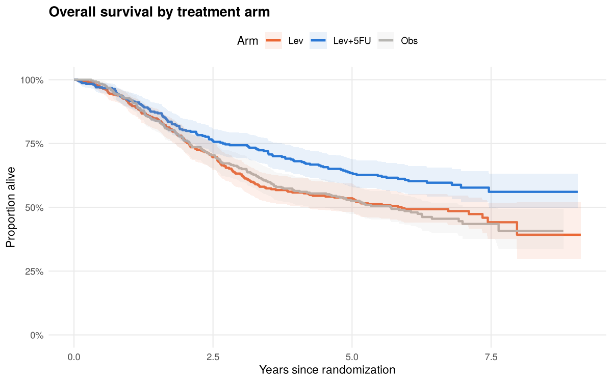
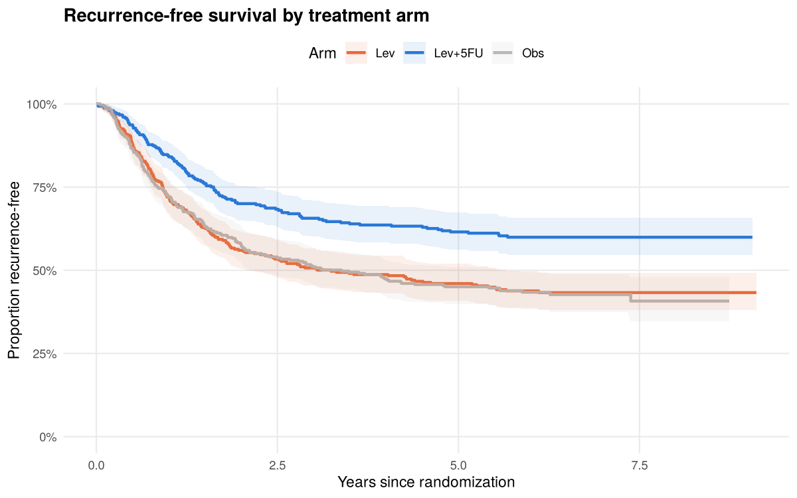
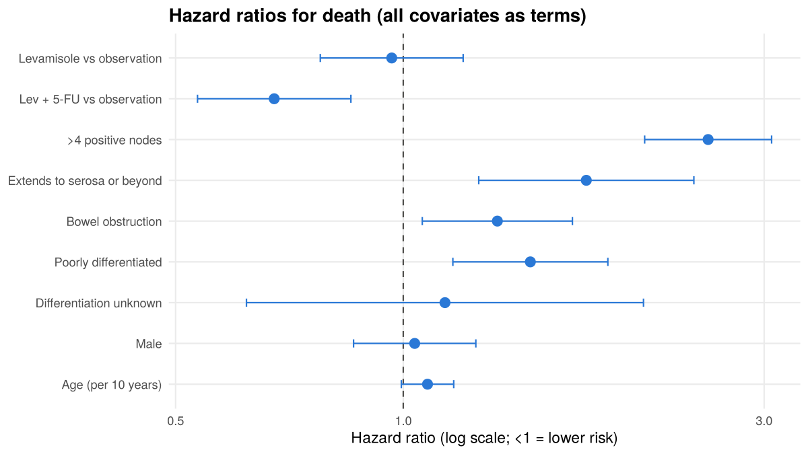

Adjuvant Chemotherapy for Stage C Colon Cancer: Reanalysis of a
Randomized Trial
================

- [Study](#study)
- [1. Did randomization balance the
  arms?](#1-did-randomization-balance-the-arms)
- [2. Overall survival (primary
  endpoint)](#2-overall-survival-primary-endpoint)
- [3. Recurrence-free survival (secondary
  endpoint)](#3-recurrence-free-survival-secondary-endpoint)
- [4. Cox proportional-hazards
  models](#4-cox-proportional-hazards-models)
  - [Prognostic factors](#prognostic-factors)
  - [4.1 Checking the proportional-hazards
    assumption](#41-checking-the-proportional-hazards-assumption)
- [5. Does the benefit depend on nodal burden? (subgroup
  analysis)](#5-does-the-benefit-depend-on-nodal-burden-subgroup-analysis)
- [6. Conclusions](#6-conclusions)

**Run it:**
`Rscript -e 'rmarkdown::render("analysis.Rmd", output_file = "README.md")'`
(needs R ≥ 4.1 with survival, dplyr, ggplot2, broom, rmarkdown; see
`install.R`). This README is the rendered report. Every number in the
text is computed in the code, not typed in.

## Study

The North Central Cancer Treatment Group / Mayo Clinic trial (Moertel et
al., *NEJM* 1990) randomized patients with resected **stage C
(node-positive) colon cancer** to:

- **Obs**: observation only
- **Lev**: levamisole
- **Lev+5FU**: levamisole plus fluorouracil

Each patient has two records in `survival::colon`, one for recurrence
(`etype = 1`) and one for death (`etype = 2`). This report checks that
randomization balanced the arms, estimates the treatment effect on
**overall survival** (primary) and **recurrence-free survival**
(secondary), adjusts for prognostic factors with Cox regression, checks
the model’s assumptions, and tests whether the effect differs by nodal
burden.

``` r
death <- prepare(colon, endpoint = 2)   # overall survival
recur <- prepare(colon, endpoint = 1)   # recurrence-free survival
c(patients = nrow(death), deaths = sum(death$status), recurrences = sum(recur$status),
  median_followup_years = round(median(death$years[death$status == 0]), 1))
```

    ##              patients                deaths           recurrences 
    ##                 929.0                 452.0                 468.0 
    ## median_followup_years 
    ##                   6.4

## 1. Did randomization balance the arms?

``` r
table1 <- baseline_table(death)
knitr::kable(table1, align = "lrrrr")
```

| characteristic                        |         Obs |         Lev |     Lev+5FU | p_value |
|:--------------------------------------|------------:|------------:|------------:|--------:|
| Patients, n                           |         315 |         310 |         304 |         |
| Age, years (mean, SD)                 | 59.5 (12.0) | 60.1 (11.6) | 59.7 (12.3) |   0.785 |
| Male                                  |   166 (53%) |   177 (57%) |   141 (46%) |   0.028 |
| Positive lymph nodes (mean, SD)       |   3.8 (3.7) |   3.7 (3.6) |   3.5 (3.4) |   0.587 |
| \>4 positive nodes                    |    87 (28%) |    89 (29%) |    79 (26%) |   0.749 |
| Bowel obstruction                     |    63 (20%) |    63 (20%) |    54 (18%) |   0.683 |
| Perforation                           |      9 (3%) |     10 (3%) |      8 (3%) |   0.907 |
| Tumour adherent to nearby organs      |    47 (15%) |    49 (16%) |    39 (13%) |   0.562 |
| Poorly differentiated                 |    52 (17%) |    44 (14%) |    54 (18%) |   0.475 |
| Extends to serosa or beyond           |   269 (85%) |   271 (87%) |   262 (86%) |   0.760 |
| Surgery \>20 days before registration |    91 (29%) |    80 (26%) |    76 (25%) |   0.511 |

``` r
pvals <- suppressWarnings(as.numeric(sub("<", "", table1$p_value)))
n_tests <- sum(!is.na(pvals)); sig <- table1$characteristic[!is.na(pvals) & pvals < 0.05]
```

1 of 10 baseline characteristics differ at p \< 0.05 (Male). With 10
tests, about 0.5 “significant” result is expected by chance alone, and
none survives a Bonferroni correction (p \< 0.005). The arms are
balanced on every strong prognostic factor (nodes, obstruction, extent,
differentiation). Sex is included in the adjusted models below as a
safeguard.

## 2. Overall survival (primary endpoint)

``` r
fit_os <- survfit(Surv(years, status) ~ rx, data = death)
km_plot(fit_os, "Overall survival by treatment arm", "Proportion alive")
```

<!-- -->

``` r
km_summary(fit_os, times = c(3, 5))
```

| arm     | year | survival | ci_95         | at_risk |
|:--------|-----:|:---------|:--------------|--------:|
| Obs     |    3 | 65.3%    | 60.3% - 70.8% |     205 |
| Obs     |    5 | 52.6%    | 47.3% - 58.4% |     160 |
| Lev     |    3 | 62.9%    | 57.7% - 68.5% |     195 |
| Lev     |    5 | 53.5%    | 48.3% - 59.4% |     164 |
| Lev+5FU |    3 | 74.3%    | 69.6% - 79.4% |     226 |
| Lev+5FU |    5 | 63.4%    | 58.2% - 69.1% |     187 |

``` r
lr_os   <- survdiff(Surv(years, status) ~ rx, data = death)
lr_os_p <- survdiff(Surv(years, status) ~ rx, data = droplevels(subset(death, rx != "Lev")))
s5 <- summary(fit_os, times = 5)$surv
```

- 5-year survival: **63.4% with Lev+5FU vs 52.6% with observation**
  (levamisole alone 53.5%)
- Log-rank, all three arms: χ² = 11.7, p = 0.0029
- Log-rank, Lev+5FU vs observation: χ² = 10, p = 0.0016

## 3. Recurrence-free survival (secondary endpoint)

``` r
fit_rfs <- survfit(Surv(years, status) ~ rx, data = recur)
km_plot(fit_rfs, "Recurrence-free survival by treatment arm", "Proportion recurrence-free")
```

<!-- -->

``` r
km_summary(fit_rfs, times = c(3, 5))
```

| arm     | year | survival | ci_95         | at_risk |
|:--------|-----:|:---------|:--------------|--------:|
| Obs     |    3 | 51.1%    | 45.8% - 56.9% |     155 |
| Obs     |    5 | 45.0%    | 39.8% - 50.9% |     128 |
| Lev     |    3 | 50.7%    | 45.4% - 56.6% |     153 |
| Lev     |    5 | 46.0%    | 40.7% - 52.0% |     135 |
| Lev+5FU |    3 | 65.6%    | 60.5% - 71.2% |     194 |
| Lev+5FU |    5 | 61.5%    | 56.2% - 67.3% |     174 |

``` r
lr_rfs <- survdiff(Surv(years, status) ~ rx, data = recur)
r5 <- summary(fit_rfs, times = 5)$surv
```

5-year recurrence-free survival: **61.5% with Lev+5FU vs 45.0% with
observation** (log-rank p = 9.8e-06).

## 4. Cox proportional-hazards models

The first adjusted model (all covariates as terms) failed the
proportional-hazards check for several **prognostic** covariates
(Section 4.1). The primary adjusted model therefore **stratifies** on
those covariates. Each stratum gets its own baseline hazard, and the
treatment hazard ratio is estimated within strata.

``` r
f_adj   <- Surv(years, status) ~ rx + node4 + extent_grp + obstruct + differ_grp + sex + age10
f_strat <- Surv(years, status) ~ rx + extent_grp + sex + age10 + strata(node4, differ_grp, obstruct)
models <- list(
  "Death, unadjusted"             = coxph(Surv(years, status) ~ rx, data = death),
  "Death, adjusted (stratified)"  = coxph(f_strat, data = death),
  "Recurrence, unadjusted"        = coxph(Surv(years, status) ~ rx, data = recur),
  "Recurrence, adjusted (stratified)" = coxph(f_strat, data = recur)
)
hr <- bind_rows(lapply(names(models), function(m) hr_table(models[[m]]) |> mutate(model = m)))
knitr::kable(filter(hr, grepl("^rx", term)) |> select(model, term, HR, CI_95, p_value))
```

| model                             | term      |   HR | CI_95       | p_value |
|:----------------------------------|:----------|-----:|:------------|:--------|
| Death, unadjusted                 | rxLev     | 0.97 | 0.78 - 1.21 | 0.809   |
| Death, unadjusted                 | rxLev+5FU | 0.69 | 0.55 - 0.87 | 0.002   |
| Death, adjusted (stratified)      | rxLev     | 0.98 | 0.79 - 1.22 | 0.861   |
| Death, adjusted (stratified)      | rxLev+5FU | 0.71 | 0.56 - 0.90 | 0.004   |
| Recurrence, unadjusted            | rxLev     | 0.98 | 0.80 - 1.21 | 0.888   |
| Recurrence, unadjusted            | rxLev+5FU | 0.60 | 0.47 - 0.76 | \<0.001 |
| Recurrence, adjusted (stratified) | rxLev     | 0.95 | 0.77 - 1.17 | 0.630   |
| Recurrence, adjusted (stratified) | rxLev+5FU | 0.59 | 0.47 - 0.75 | \<0.001 |

``` r
hr_d <- filter(hr, model == "Death, adjusted (stratified)", term == "rxLev+5FU")
hr_r <- filter(hr, model == "Recurrence, adjusted (stratified)", term == "rxLev+5FU")
```

- **Levamisole + 5-FU reduced the hazard of death by 29%** (HR 0.71, 95%
  CI 0.56 - 0.90) and the **hazard of recurrence by 41%** (HR 0.59, 95%
  CI 0.47 - 0.75).
- Levamisole alone had no detectable effect on either endpoint.
- Adjustment barely moves the estimates, as expected when randomization
  worked.

### Prognostic factors

``` r
cox_terms <- coxph(f_adj, data = death)
forest_plot(hr_table(cox_terms), "Hazard ratios for death (all covariates as terms)")
```

<!-- -->

``` r
prog <- hr_table(cox_terms) |> filter(term == "node4>4 nodes")
```

More than 4 positive lymph nodes is the strongest prognostic factor (HR
2.53, 95% CI 2.09 - 3.07). Hazard ratios for covariates that violate
proportional hazards are **averages over follow-up** and should be read
as such.

### 4.1 Checking the proportional-hazards assumption

``` r
zph_terms <- cox.zph(cox_terms)
zph_strat <- cox.zph(models[["Death, adjusted (stratified)"]])
knitr::kable(zph_df(zph_terms), caption = "All covariates as terms")
```

| term       | chisq |  df |       p |
|:-----------|------:|----:|--------:|
| rx         |  2.25 |   2 | 3.3e-01 |
| node4      |  5.31 |   1 | 2.1e-02 |
| extent_grp |  4.98 |   1 | 2.6e-02 |
| obstruct   |  6.14 |   1 | 1.3e-02 |
| differ_grp | 16.97 |   2 | 2.1e-04 |
| sex        |  0.90 |   1 | 3.4e-01 |
| age10      |  0.63 |   1 | 4.3e-01 |
| GLOBAL     | 35.10 |   9 | 5.7e-05 |

All covariates as terms

``` r
knitr::kable(zph_df(zph_strat), caption = "Primary model: stratified on nodes, differentiation, obstruction")
```

| term       | chisq |  df |    p |
|:-----------|------:|----:|-----:|
| rx         |  1.62 |   2 | 0.44 |
| extent_grp |  2.69 |   1 | 0.10 |
| sex        |  0.16 |   1 | 0.69 |
| age10      |  1.03 |   1 | 0.31 |
| GLOBAL     |  5.44 |   5 | 0.36 |

Primary model: stratified on nodes, differentiation, obstruction

``` r
viol <- rownames(zph_terms$table)[zph_terms$table[, "p"] < 0.05 & rownames(zph_terms$table) != "GLOBAL"]
```

Covariates whose effect changes over time in the all-terms model:
**node4, extent_grp, obstruct, differ_grp**. The **treatment term
satisfies the assumption** in both models (p = 0.33 and 0.44), so the
treatment hazard ratio is a valid summary of the effect over follow-up.

## 5. Does the benefit depend on nodal burden? (subgroup analysis)

``` r
cox_main <- coxph(Surv(years, status) ~ rx + node4, data = death)
cox_int  <- coxph(Surv(years, status) ~ rx * node4, data = death)
p_int <- anova(cox_main, cox_int)[["Pr(>|Chi|)"]][2]
sub <- bind_rows(lapply(split(death, death$node4), function(d) {
  hr_table(coxph(Surv(years, status) ~ rx, data = d)) |> filter(grepl("^rx", term)) |> mutate(subgroup = as.character(d$node4[1]))
}))
knitr::kable(sub |> select(subgroup, term, HR, CI_95, p_value))
```

| subgroup  | term      |   HR | CI_95       | p_value |
|:----------|:----------|-----:|:------------|:--------|
| 1-4 nodes | rxLev     | 0.92 | 0.70 - 1.22 | 0.583   |
| 1-4 nodes | rxLev+5FU | 0.66 | 0.49 - 0.89 | 0.006   |
| \>4 nodes | rxLev     | 1.02 | 0.73 - 1.44 | 0.889   |
| \>4 nodes | rxLev+5FU | 0.74 | 0.51 - 1.07 | 0.105   |

Treatment × nodes interaction: p = 0.897. The point estimates differ
between subgroups, but the interaction test gives no evidence that the
benefit really differs. The subgroup with \>4 nodes is smaller, so its
confidence interval is wider. The overall hazard ratio remains the best
estimate for both groups.

## 6. Conclusions

1.  Randomization produced well-balanced arms. The one nominal imbalance
    (sex) is consistent with chance and was adjusted for.
2.  **Levamisole + 5-FU improved survival.** At 5 years, 63.4% of
    patients were alive versus 52.6% with observation, and the adjusted
    hazard of death was 29% lower. This is consistent with the original
    publication, which made the regimen standard adjuvant therapy in
    1990.
3.  **Levamisole alone was ineffective.** The benefit comes from adding
    fluorouracil.
4.  Several prognostic factors violate proportional hazards. Stratifying
    on them leaves the treatment effect unchanged, and the treatment
    term itself satisfies the assumption.
5.  There is no reliable evidence that the benefit differs by nodal
    burden.

*Data: `survival::colon`, R package survival. Moertel CG et
al. Levamisole and fluorouracil for adjuvant therapy of resected colon
carcinoma. N Engl J Med 1990;322:352-8. Educational reanalysis.
Treatment standards have since changed.*
